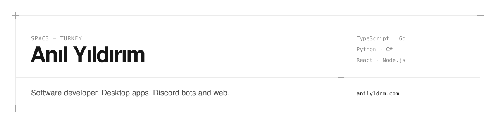

<picture>
  <source media="(prefers-color-scheme: dark)" srcset="assets/banner-dark.svg">
  
</picture>

I build the tools I want to use myself: Windows desktop apps, Discord bots and small web apps.
Most of my work is in TypeScript, Go, Python and C#.

[Website](https://anilyldrm.com) · [Discord](https://discord.com/invite/AMGuCHx9TJ)

### Selected work

| Project | What it does | Stack | |
| --- | --- | --- | --- |
| **ValStore** | Valorant store tracker: daily store, night market, battle pass, collection value, match history and post-match reports. Discord bot, web panel and browser extension. | Python · FastAPI | Private |
| **Rafta** | Cosmetics decision assistant. Search or scan a barcode and get reviews, social videos and prices on one page. Installable PWA. | Next.js · Supabase | Private |
| **[LunaProxy](https://github.com/Anilyldrmm/LunaProxy)** | One-click DPI bypass proxy for Windows, for the PC and every device on the network. Built on GoodbyeDPI. | Go | [Download](https://github.com/Anilyldrmm/LunaProxy/releases/latest) |
| **Discord Log Bot** | Logs voice, message, moderation and role events to a channel and SQLite. Owner-only web panel behind Discord OAuth. | Node.js · SQLite | Private |
| **[SpAC3Deck](https://github.com/Anilyldrmm/SpAC3Deck)** | Stream Deck–style control panel. Control Discord, Voicemeeter, Steam and hotkeys from your phone over LAN. | Python · JS | [Download](https://github.com/Anilyldrmm/SpAC3Deck/releases/latest) |
| **Kick Verification Bot** | Makes Discord members verify their Kick account through OAuth2. One-to-one account linking, automatic nicknames and roles, bans, reminders and a web admin dashboard. | TypeScript · MongoDB | Private |

### Also

- **LoL Coach**: reads your live League of Legends match through the Riot API and suggests items and runes. Discord bot and web UI. *Private*
- **instaunfollower**: Discord bot that DMs you when someone unfollows you on Instagram. *Private*
- **Nightwatch**: .NET / WPF app for Windows that watches Twitch drop campaigns and claims the rewards for you. *Private*
- **[claude-starter-kit](https://github.com/Anilyldrmm/claude-starter-kit)**: ready-made Claude Code setup with skills, agents, plugins and MCP config.
- **[yt-indirici](https://github.com/Anilyldrmm/yt-indirici)**: Chrome/Edge extension that downloads video or audio from about 1,800 sites through yt-dlp.

### Stack

| | |
| --- | --- |
| **Languages** | TypeScript, JavaScript, Python, Go, C# |
| **Frontend** | React, Next.js, Vite, Tailwind CSS, PWAs, browser extensions |
| **Backend** | Node.js, Express, FastAPI, WebSockets |
| **Bots & APIs** | discord.js, discord.py, Kick OAuth, Riot API, Twitch |
| **Desktop** | .NET / WPF, Go with WebView2, pywebview, PyInstaller |
| **Data** | PostgreSQL (Neon, Supabase), MongoDB, SQLite, Drizzle ORM |
| **Auth** | OAuth2 with PKCE, NextAuth, JWT |
| **Infra** | Docker, Railway, Vercel, Cloudflare Workers, GitHub Actions |
| **Testing** | Vitest, pytest, Go test |
